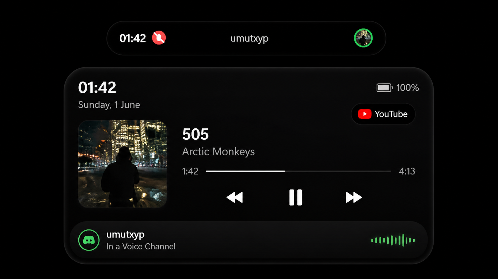

# Advanced Dynamic Island for Windows

An iOS-inspired Dynamic Island for the top centre of your Windows desktop. It is a lightweight **C# / WPF / .NET 8** desktop application with media controls, notifications, an audio visualizer, quick views, and optional Discord voice presence.



## Highlights

- Compact idle and media-aware island with track title, artist, source-app icon, album art, transport controls, and live timeline.
- 20-band WASAPI loopback FFT visualizer with adaptive accent colours extracted from album art.
- Windows notification listener that presents supported toast notifications in the island.
- Expandable views for media, calendar, file tray, connected Bluetooth devices, and Discord voice channels.
- Drag-and-drop file tray. Items are persisted under `%APPDATA%\DynamicIsland\tray.json`.
- Three themes: Floating, Attached, and Glass.
- Optional startup-with-Windows setting (per-user; administrator access is not required).
- Optional Discord local RPC integration showing a voice channel, members, avatars, and active speakers.
- 32 interface languages: English, Turkish, Arabic, Bulgarian, Czech, Danish, German, Greek, Spanish, Finnish, French, Hebrew, Hindi, Hungarian, Indonesian, Italian, Japanese, Korean, Malay, Norwegian Bokmål, Dutch, Polish, Brazilian Portuguese, Romanian, Russian, Slovak, Swedish, Thai, Ukrainian, Vietnamese, Simplified Chinese, and Traditional Chinese.

## Supported platforms

| Platform | Status | Notes |
| --- | --- | --- |
| Windows 10 version 2004 (build 19041) or newer | Supported | Required for the Windows media-control APIs used by the app. |
| Windows 11 | Supported | Recommended for the best notification and visual experience. |
| macOS / Linux | Not supported | This project uses WPF, WinRT, and Windows audio APIs. |

## Requirements

- Windows 10 version 2004 or later, or Windows 11
- .NET 8 Desktop Runtime to run a framework-dependent build
- .NET 8 SDK to build from source
- An active audio output device for the visualizer
- Discord Desktop and your own Discord Developer Application only if you enable Discord voice integration

## Run from source

Clone the repository, open a terminal in this directory, then run:

```powershell
dotnet restore
dotnet build .\DynamicIsland.csproj -c Release
.\bin\Release\net8.0-windows10.0.19041.0\DynamicIsland.exe
```

For a portable self-contained publish (no installed .NET runtime required):

```powershell
dotnet publish .\DynamicIsland.csproj -c Release -r win-x64 --self-contained true -p:PublishSingleFile=true
```

The output is placed under `bin\Release\net8.0-windows10.0.19041.0\win-x64\publish`.

## How to use

1. Launch the application. The island appears at the top centre of the primary desktop work area.
2. Hover over the island to expand it. Use the mouse wheel or the navigation dots to switch between enabled views.
3. Play media in any application that exposes Windows System Media Transport Controls (for example Spotify, browsers, or media players). The island automatically updates.
4. Right-click the tray icon and choose **Settings** to change the language, theme, enabled modules, tabs, and startup behaviour.
5. Drag files or folders onto the island to add them to the File Tray. Double-click an item to open it; right-click it to remove it.

### Command-line options

| Command | Purpose |
| --- | --- |
| `DynamicIsland.exe --settings` | Opens Settings on startup. |
| `DynamicIsland.exe --expand` | Opens the expanded island for UI testing. |
| `DynamicIsland.exe --expand --view N` | Opens a specific view (`0` Media, `1` Calendar, `2` File Tray, `3` Bluetooth, `4` Discord). |

## Language support

Choose a language from **Settings → Language**. The language picker is data-driven, so new translations are added by placing a UTF-8 JSON file in `Languages` and registering its code and display name in `SupportedLanguages`.

Every language falls back to English for a string that is not present in its translation file. This makes partial translations safe and prevents raw translation keys from appearing in the UI.

## Discord voice integration

Discord integration is optional and stays inactive until credentials are provided.

1. Create an application at [Discord Developer Portal](https://discord.com/developers/applications).
2. In **OAuth2 → Redirects**, add exactly `http://127.0.0.1`.
3. Copy the application **Client ID** and **Client Secret** into **Settings → Discord**, then save.
4. Keep Discord Desktop running and approve the first authorization prompt.
5. Join a voice channel.

The app uses Discord's local RPC with the `rpc` and `rpc.voice.read` scopes. OAuth tokens and app settings are stored locally in `%APPDATA%\DynamicIsland`; do not share that directory.

## Notifications and privacy

The notification view uses the Windows `UserNotificationListener` API. Windows may ask for permission; if notifications do not appear, review the notification/privacy permissions in Windows Settings. Notification contents are shown in the island only and are not sent to a remote service by this project.

## Performance and reliability

- Media and notification polling prevent overlapping requests, which avoids queued UI work when Windows APIs are slow.
- The visualizer reuses its FFT buffer to avoid high-frequency allocations.
- Memory cleanup is conservative: it only runs periodically when the working set is high, avoiding forced full-GC pauses during normal use.
- Background, task, and UI exceptions are logged to `%APPDATA%\DynamicIsland\app.log` to aid troubleshooting.

## Project layout

| Directory | Purpose |
| --- | --- |
| `Core/` | Settings, localization, media, notification, audio, Bluetooth, Discord, logging, and startup services. |
| `Languages/` | UTF-8 JSON interface translations. |
| `Presence/` | Source/presence providers for media applications. |
| `Themes/` | WPF resource dictionaries for the included island themes. |
| `UI/` | Island window, settings window, and tray icon. |

## Troubleshooting

- **The island does not show media:** start playback in an app that supports Windows media controls, then wait up to one second.
- **The visualizer is idle:** make sure an audio output device is active and that the visualizer module is enabled in Settings.
- **Notifications do not appear:** enable the Notifications module and grant Windows notification-listener access.
- **Discord does not connect:** verify the Client ID, Client Secret, redirect URI, Discord Desktop status, and authorization prompt.
- **An error occurs:** check `%APPDATA%\DynamicIsland\app.log` before opening an issue.

## License

Released under the [MIT License](LICENSE).
